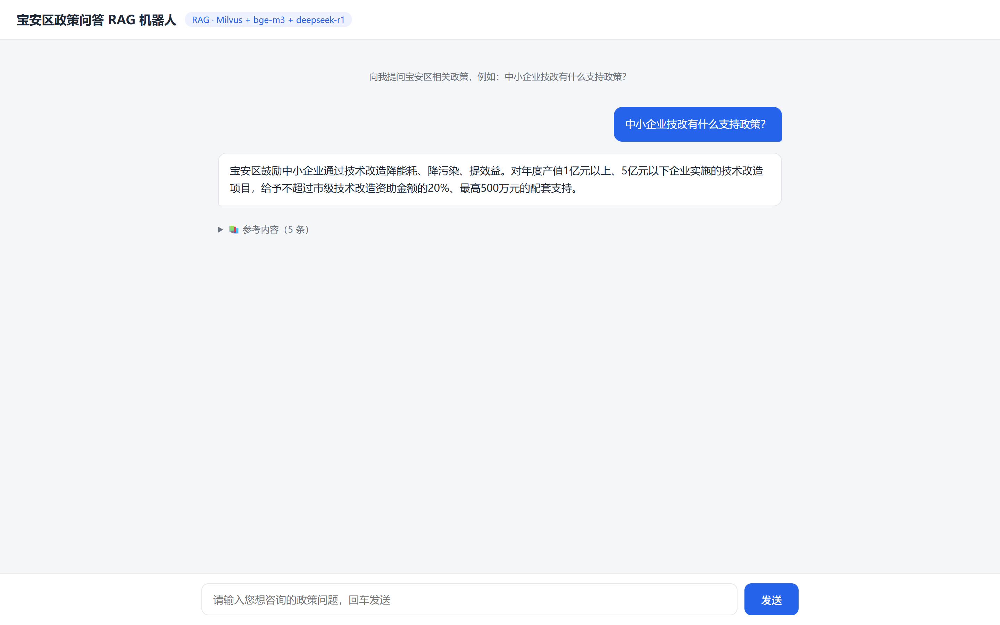

# 宝安区政策问答 RAG 机器人

基于宝安区政策问答知识库（3823 条问答对）构建的检索增强生成（RAG）问答机器人。
用户提问 → 向量检索召回相关问答 → 本地大模型生成答案 → 回答并**标注参考内容**（命中问答对 + 相似度）。

运行效果（`docs/demo.png`）：



---

## 一、项目目录架构

```
rag-policy-qa/
├── config.py                    # 全局配置：Milvus/Ollama 地址、collection 名、模型名、检索参数（支持环境变量覆盖）
├── requirements.txt             # Python 依赖清单
├── Dockerfile                   # 应用镜像构建
├── docker-compose.yml           # 容器编排（app + 可选 milvus/ollama）
├── .dockerignore / .gitignore   # 构建/版本控制忽略清单
├── README.md                    # 本文档
├── docs/
│   └── demo.png                 # 运行效果截图
├── data/
│   ├── knowledgeBase.xlsx       # 源数据（宝安区政策问答知识库，3823 条 question/answer）
│   ├── qa.jsonl                 # 抽取后的问答对（extract.py 生成）
│   └── .embed_cache/            # 向量化批次缓存（支持中断续跑，不入库/镜像）
├── scripts/
│   ├── extract.py               # 数据抽取：xlsx → qa.jsonl
│   └── build_index.py           # 建索引：向量化 qa.jsonl → 写入 Milvus
└── app/
    ├── __init__.py
    ├── main.py                  # FastAPI 后端：/api/ask 接口 + 静态页
    ├── rag.py                   # RAG 核心：embed_query / search / generate / ask
    └── static/
        └── index.html           # 前端对话页面
```

---

## 二、实现方案

### 1. 整体数据流

```
knowledgeBase.xlsx (3823 条问答对)
        │  extract.py（openpyxl 读取，去空值）
        ▼
qa.jsonl [{id, question, answer}, ...]
        │  build_index.py（bge-m3 向量化 + 批次缓存）
        ▼
Milvus collection "policy_qa"（向量 + 原文元数据）
        │
        ▼  ── 运行时 ──
用户提问 ──> embed_query(bge-m3) ──> Milvus 向量检索 top-k
        │                                    │
        │                          命中参考问答对（question/answer/id/score）
        ▼                                    ▼
   deepseek-r1:1.5b 生成答案 ◄── 拼接为上下文 prompt
        │
        ▼
返回 { answer, sources }  ← 答案 + 标注的参考内容
```

### 2. 技术选型

| 环节 | 选型 | 说明 |
|------|------|------|
| 数据源 | `knowledgeBase.xlsx` | 3823 条宝安区政策问答对（question/answer） |
| 向量库 | Milvus 2.6.1（standalone） | collection `policy_qa`，主键 int64，1024 维浮点向量 |
| Embedding | Ollama `bge-m3` | 1024 维，CPU 推理，批量调用 `/api/embed` |
| 生成模型 | Ollama `deepseek-r1:1.5b` | 本地推理，131K 上下文，`/api/generate` |
| 后端 | FastAPI + uvicorn | `/api/ask` 接口 + 静态页面 |
| 前端 | 原生 HTML + fetch | 对话界面 + 参考内容卡片 |
| 部署 | Docker + docker-compose | 应用容器化，依赖 Milvus/Ollama 服务 |

### 3. 检索（`app/rag.py` 的 `search`）

- 用 bge-m3 将查询文本向量化
- 在 Milvus 上做余弦相似度（COSINE）检索，`IVF_FLAT` 索引，nlist=128，检索时 nprobe=16
- 默认召回 top-k=5 条，返回每条命中的 `id / question / answer / score`

### 4. 生成（`app/rag.py` 的 `generate`）

- 将 top-k 条参考问答对拼接为上下文 prompt
- 调 deepseek-r1:1.5b 生成答案（temperature=0.3，num_predict=256，超时 120s）
- **降级策略**：LLM 生成失败或超时时，直接返回相似度最高的原文答案，保证服务可用

### 5. 参考内容标注（作业要求）

- 每个回答的返回结构统一为 `{ answer, sources }`
- `sources` 为命中的参考问答对列表，前端以「📚 参考内容」折叠卡片展示，含：
  - 问答编号（`#id`）
  - 相似度得分（`score`）
  - 命中的原始「问题」与「答案」

---

## 三、环境依赖

| 依赖 | 说明 |
|------|------|
| Milvus 2.6.1 | 向量库，端口 19530（standalone 自带 WebUI 在 9091） |
| Ollama | 本地模型服务，端口 11434，需已 pull `bge-m3` 和 `deepseek-r1:1.5b` |
| Docker + docker-compose | 应用容器化部署 |

---

## 四、部署与使用

### 方式 A：Docker 部署（推荐）

```bash
cd rag-policy-qa
docker compose up -d --build
```

构建完成后，应用容器运行在 **http://127.0.0.1:8000**。

> 前置条件：本机已运行 Milvus（19530）与 Ollama（11434），且 Milvus 中已建好 `policy_qa` collection。
> 若还没有索引，先在宿主机执行一次建库（见下方「数据准备」），再启动容器。

### 方式 B：本地直接运行

```bash
pip install -r requirements.txt
uvicorn app.main:app --host 127.0.0.1 --port 8000
```

### 数据准备（首次，一次性）

1. 抽取数据：

   ```bash
   python scripts/extract.py --limit 0        # 全量抽取（--limit 200 采样）
   ```

2. 建索引（向量化 + 写入 Milvus）：

   ```bash
   # 务必加 -u，避免输出缓冲导致进度不刷新
   python -u scripts/build_index.py --limit 0   # 全量（约 10-15 分钟）
   # python -u scripts/build_index.py --drop     # 重建前先清空旧数据
   ```

   > 中断后重跑会自动跳过已完成批次（`data/.embed_cache/` 缓存），无需从头开始。

---

## 五、怎么看前端

1. **启动后**，在浏览器打开 **http://127.0.0.1:8000**（Docker 或本地运行都是这个地址）。
2. 页面顶部是标题栏，中间是对话区，底部是输入框。
3. 在输入框输入政策问题（例如「中小企业技改有什么支持政策？」），按 **回车** 或点「发送」。
4. 几秒到几十秒后（本地 CPU 生成较慢），页面会显示：
   - **回答**：蓝色卡片（你的问题在右侧，助手答案在左侧）
   - **📚 参考内容**：答案下方的折叠面板，点击展开可看到命中的问答对，每条含编号、相似度得分、原始问题与答案。
5. 接口自测（可选）：
   - 健康检查：`GET http://127.0.0.1:8000/api/health`
   - 问答接口：`POST http://127.0.0.1:8000/api/ask`，body `{"question": "专利方面有什么奖励政策？"}`

---

## 六、API 说明

| 方法 | 路径 | 说明 |
|------|------|------|
| GET | `/` | 前端对话页面 |
| GET | `/api/health` | 健康检查，返回 collection 是否就绪 |
| POST | `/api/ask` | 入参 `{"question": "...", "top_k": 5}`，返回 `{"answer": "...", "sources": [...]}` |

---

## 七、关键配置（`config.py`，支持环境变量覆盖）

| 配置项 | 环境变量 | 默认值 | 说明 |
|--------|----------|--------|------|
| `MILVUS_HOST` | `MILVUS_HOST` | 127.0.0.1 | Milvus 地址 |
| `MILVUS_PORT` | `MILVUS_PORT` | 19530 | Milvus 端口 |
| `COLLECTION_NAME` | `COLLECTION_NAME` | `policy_qa` | collection 名 |
| `OLLAMA_BASE_URL` | `OLLAMA_BASE_URL` | http://127.0.0.1:11434 | Ollama 地址 |
| `EMBED_MODEL` | `EMBED_MODEL` | `bge-m3:latest` | embedding 模型 |
| `LLM_MODEL` | `LLM_MODEL` | `deepseek-r1:1.5b` | 生成模型 |
| `TOP_K` | — | 5 | 召回条数 |
| `EMBED_BATCH_SIZE` | — | 16 | 每批向量化条数 |
| `LLM_TIMEOUT` | — | 120 | 生成超时（秒） |

> Docker 内访问宿主机服务使用 `host.docker.internal`，已通过环境变量注入（见 `docker-compose.yml`）。

## 八、CI/CD（GitHub Actions）

推送到 `main`、提交 Pull Request 或手动运行时，工作流会使用 Python 3.11 安装依赖、检查语法并运行无需外部服务的单元测试，随后构建 Docker 镜像并验证容器首页可以访问。仅在推送到 `main` 且检查通过后，工作流使用 `GITHUB_TOKEN` 将镜像发布到 GitHub Container Registry：

- `ghcr.io/<仓库所有者>/policy_qa_robot:latest`
- `ghcr.io/<仓库所有者>/policy_qa_robot:sha-<完整提交 SHA>`

镜像名中的仓库所有者会转换为小写。首次发布可能需要在仓库设置中允许 GitHub Actions 写入 Packages；私有镜像拉取需要有权限的账号登录 GHCR。此流程交付镜像，不会自动更新服务器：运行镜像仍需可访问已建好索引的 Milvus 和已准备好模型的 Ollama。单元测试使用模拟对象，容器冒烟测试只验证应用启动与首页，不覆盖真实检索和模型推理。
